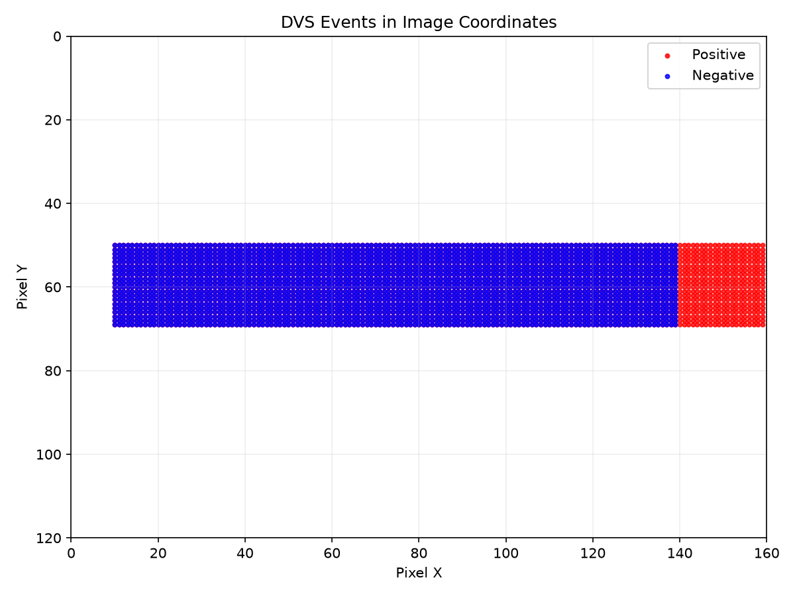
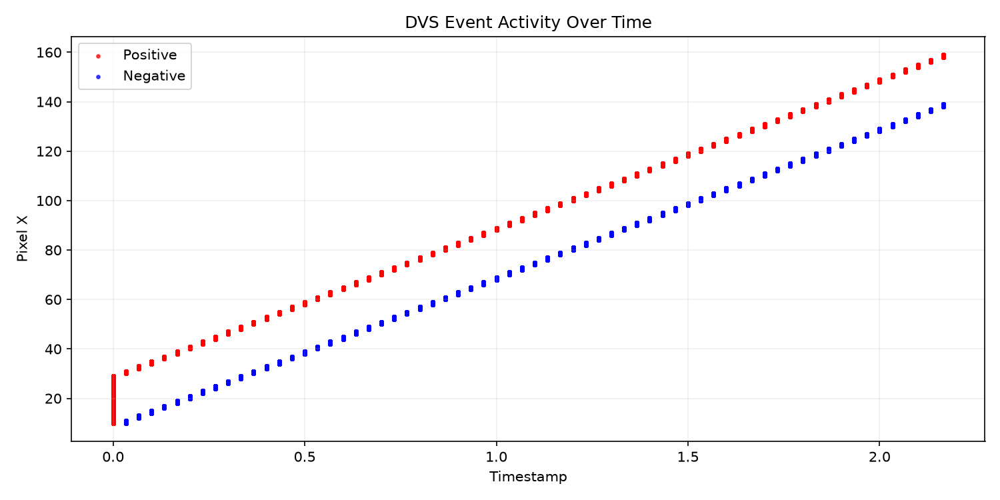
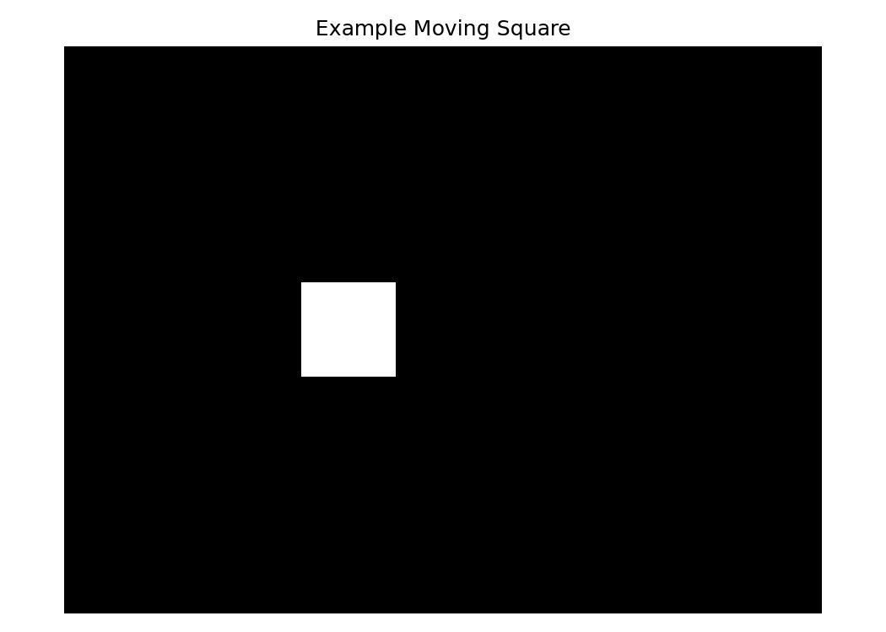
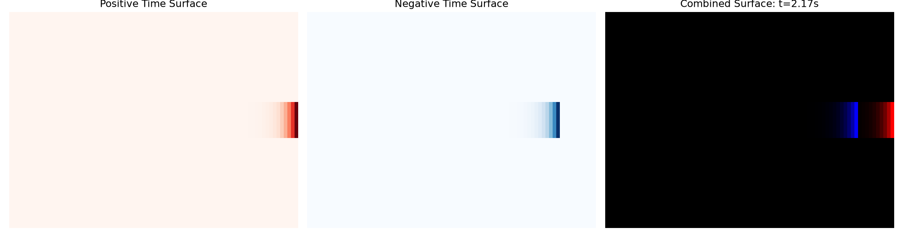
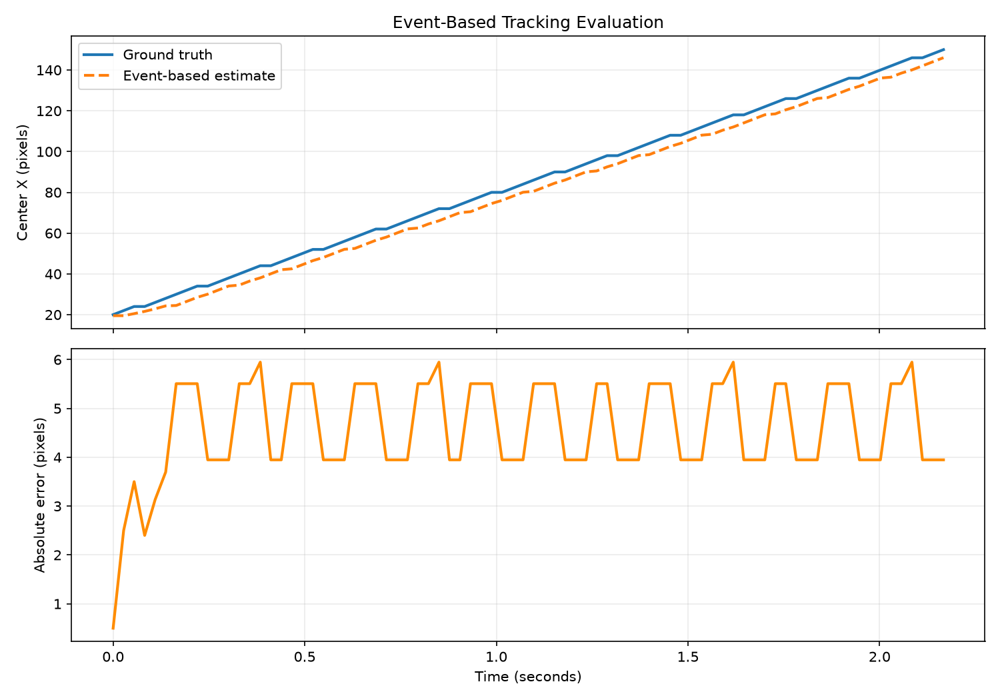
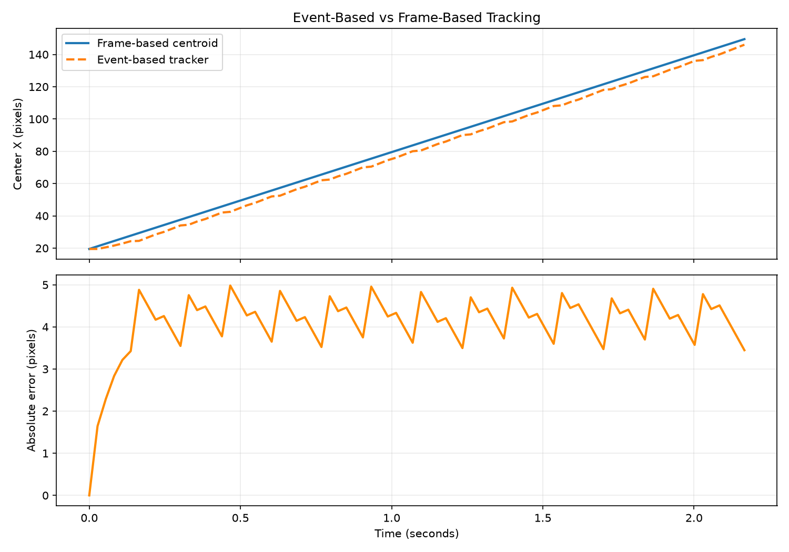

# Neuromorphic Event-Based Vision for Low-Latency Motion Tracking

A Python-based prototype for tracking a moving object using asynchronous DVS-like events and time-surface representation.

## Overview

Conventional cameras process complete image frames at a fixed frame rate. A Dynamic Vision Sensor (DVS), however, reports events only when the brightness of individual pixels changes.

Each event is represented as:

```text
(x, y, timestamp, polarity)
```

This project simulates the event-driven sensing process and evaluates whether a time-surface-based pipeline can track motion while processing significantly fewer visual samples than conventional full-frame processing.

## Research Question

> Can asynchronous event-based vision track a moving object with low tracking error while processing significantly fewer visual samples than conventional frame-based processing?

## Pipeline

```text
Synthetic Moving Object
        ↓
DVS Event Generation
        ↓
Event Preprocessing
        ↓
Time-Surface Construction
        ↓
Event-Based Motion Tracking
        ↓
Tracking Error Evaluation
        ↓
Frame-Based Comparison
        ↓
Visualization and Animation
```

## Main Features

- Synthetic DVS event generation
- Positive and negative event polarity handling
- Human-readable CSV event export
- Exponential time-surface representation
- Centroid-based motion tracking
- Tracking error evaluation
- Frame-based centroid comparison
- Event-density and data-reduction analysis
- Animated event-based tracking visualization
- Fully Python-based implementation

## Method

For every pixel, the latest event timestamp is stored. The time surface is generated using exponential decay:

```text
S(x, y) = exp(-(t - t_last(x, y)) / tau)
```

Where:

- `S(x, y)` is the time-surface intensity
- `t` is the current timestamp
- `t_last(x, y)` is the latest event timestamp at pixel `(x, y)`
- `tau` is the decay time constant

Recent events produce higher intensity, while older events gradually fade.

## Event Representation

Each event contains four values:

```text
[x, y, timestamp, polarity]
```

Where:

- `x` — horizontal pixel coordinate
- `y` — vertical pixel coordinate
- `timestamp` — event occurrence time
- `polarity = 1` — brightness increase
- `polarity = -1` — brightness decrease

## Project Structure

```text
.
├── src/
│   ├── event_simulator.py
│   ├── time_surface.py
│   ├── tracker.py
│   ├── evaluate.py
│   ├── compare_baseline.py
│   └── animation.py
├── outputs/
│   ├── figures/
│   │   ├── baseline_comparison.png
│   │   ├── event_stream.png
│   │   ├── event_timeline.png
│   │   ├── event_xy.png
│   │   ├── example_frame.png
│   │   ├── time_surface_00.png
│   │   ├── time_surface_01.png
│   │   ├── time_surface_02.png
│   │   ├── time_surface_03.png
│   │   ├── time_surface_04.png
│   │   ├── time_surface_05.png
│   │   ├── tracking_evaluation.png
│   │   ├── tracking_path.png
│   │   └── tracking_x_over_time.png
│   ├── events.npy
│   ├── events.csv
│   ├── frames.npy
│   ├── time_surfaces.npy
│   ├── tracking_results.npy
│   ├── metrics.txt
│   ├── baseline_comparison.txt
│   └── event_tracking.gif
├── requirements.txt
└── README.md
```

## Requirements

- Python 3.8 or newer
- NumPy
- Matplotlib
- Pillow

## Installation

Install the required Python packages:

```bash
python3 -m pip install -r requirements.txt
```

If `python3` is not available, use:

```bash
python -m pip install -r requirements.txt
```

## Run the Complete Pipeline

Run the scripts in the following order:

```bash
python3 src/event_simulator.py
python3 src/time_surface.py
python3 src/tracker.py
python3 src/evaluate.py
python3 src/compare_baseline.py
python3 src/animation.py
```

The complete pipeline performs the following operations:

1. Generates a synthetic moving square
2. Converts brightness changes into DVS-like events
3. Saves events in NumPy and CSV formats
4. Builds exponential time surfaces
5. Estimates the moving object's position
6. Calculates tracking error
7. Compares event-based tracking with frame-based tracking
8. Generates figures and an animated GIF

## Run Individual Components

### Generate Synthetic Events

```bash
python3 src/event_simulator.py
```

Generated files:

```text
outputs/events.npy
outputs/events.csv
outputs/frames.npy
outputs/figures/event_stream.png
outputs/figures/event_xy.png
outputs/figures/event_timeline.png
outputs/figures/example_frame.png
```

### Generate Time Surfaces

```bash
python3 src/time_surface.py
```

Generated files:

```text
outputs/time_surfaces.npy
outputs/figures/time_surface_00.png
outputs/figures/time_surface_01.png
outputs/figures/time_surface_02.png
outputs/figures/time_surface_03.png
outputs/figures/time_surface_04.png
outputs/figures/time_surface_05.png
```

### Track the Moving Object

```bash
python3 src/tracker.py
```

Generated files:

```text
outputs/tracking_results.npy
outputs/figures/tracking_x_over_time.png
outputs/figures/tracking_path.png
```

### Evaluate Tracking Performance

```bash
python3 src/evaluate.py
```

Generated files:

```text
outputs/metrics.txt
outputs/figures/tracking_evaluation.png
```

### Compare with Frame-Based Processing

```bash
python3 src/compare_baseline.py
```

Generated files:

```text
outputs/baseline_comparison.txt
outputs/figures/baseline_comparison.png
```

### Generate the Animation

```bash
python3 src/animation.py
```

Generated file:

```text
outputs/event_tracking.gif
```

## Experimental Results

The current synthetic experiment produced the following results:

| Metric | Result |
|---|---:|
| Event-based tracking MAE | Approximately 4.59 pixels |
| Total events | 5,600 |
| Full-frame pixel samples | 1,536,000 |
| Event density | Approximately 0.36% |
| Estimated processed-sample reduction | Approximately 99.64% |

### Result Interpretation

The event stream contains approximately 0.36% as many visual samples as the equivalent full-frame processing setup.

This corresponds to an estimated 99.64% reduction in processed visual samples:

```text
Event density = 0.3646%
Estimated sample reduction = 99.6354%
```

The estimated reduction refers to processed visual samples. It is not a direct measurement of hardware energy consumption.

The prototype achieved an event-based tracking mean absolute error of approximately 4.59 pixels.

## Important Note About Energy Efficiency

This project estimates data sparsity and processed-sample reduction. It does not directly measure:

- Electrical power consumption
- Hardware energy per event
- GPU or CPU wattage
- Sensor-level power consumption
- Neuromorphic-chip energy efficiency

Therefore, the result should be described as:

> Estimated reduction in processed visual samples

It should not be described as:

> Measured energy savings

Actual energy measurements would require deployment on embedded hardware or a neuromorphic vision platform.

## Visual Results

### Event Locations



### Event Activity Over Time



### Example Input Frame



### Time-Surface Representation



### Tracking Evaluation



### Event-Based and Frame-Based Comparison



### Animated Tracking Demonstration

The complete event-based tracking demonstration is available here:

```text
outputs/event_tracking.gif
```

## Output File Description

| File | Description |
|---|---|
| `events.npy` | Binary NumPy event array |
| `events.csv` | Human-readable event table |
| `frames.npy` | Synthetic grayscale frames |
| `time_surfaces.npy` | Generated time-surface images |
| `tracking_results.npy` | Estimated tracking coordinates |
| `metrics.txt` | Tracking and event-sparsity metrics |
| `baseline_comparison.txt` | Event-based and frame-based comparison |
| `event_tracking.gif` | Animated event-tracking demonstration |

## Limitations

This project is a synthetic proof-of-concept and has several limitations:

1. It uses simulated DVS events instead of data collected from a physical event camera.
2. It does not use a public event-camera dataset.
3. It does not directly measure hardware energy consumption.
4. The tracking method is centroid-based.
5. The frame-based comparison uses a simple centroid detector.
6. The current experiment contains one moving object with a fixed motion pattern.
7. The system has not yet been tested under complex backgrounds or real-world noise.

## Future Work

Possible future improvements include:

- Evaluate the method on the DVS Gesture dataset
- Evaluate the method on the N-MNIST dataset
- Use a real event-camera recording
- Add realistic sensor noise
- Test variable-speed motion
- Track multiple objects
- Implement event-based optical flow
- Compare different time constants
- Add machine-learning-based event tracking
- Implement a spiking neural network
- Deploy the system on Raspberry Pi or NVIDIA Jetson
- Measure actual CPU, GPU and embedded-device power consumption
- Explore deployment on neuromorphic hardware

## Reproducibility

The entire project can be reproduced using the following commands:

```bash
python3 -m pip install -r requirements.txt

python3 src/event_simulator.py
python3 src/time_surface.py
python3 src/tracker.py
python3 src/evaluate.py
python3 src/compare_baseline.py
python3 src/animation.py
```

All generated data and visualizations are saved in the `outputs/` directory.

## Conclusion

This project demonstrates a complete Python-based neuromorphic event-vision pipeline.

A synthetic moving object was converted into asynchronous DVS-like events. These events were transformed into time surfaces and used for motion tracking. The event-based method achieved an average tracking error of approximately 4.59 pixels while processing a highly sparse event representation.

The results support the potential of event-based vision for low-latency and data-efficient perception. Further evaluation on real event-camera datasets and embedded hardware is required to validate performance in practical applications.

## Author

Developed as a research-oriented prototype in neuromorphic event-based vision.
